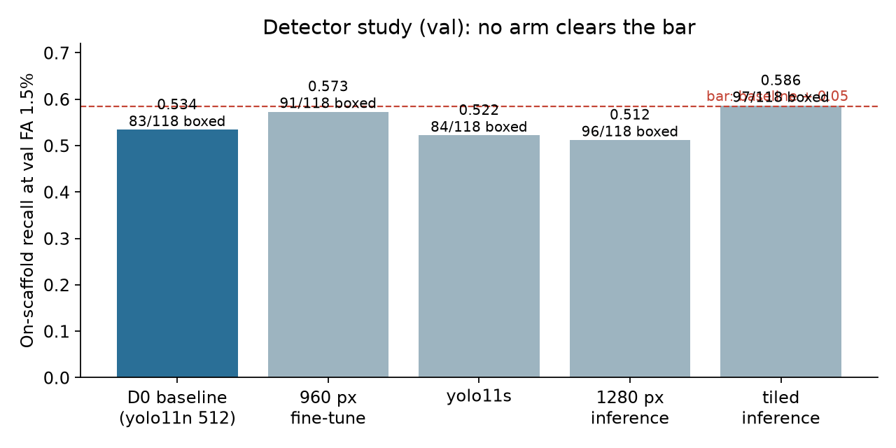
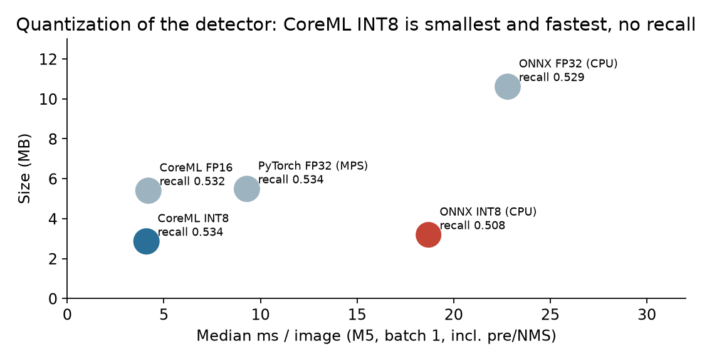
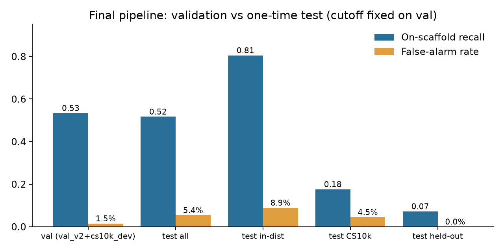

# Final results: training, quantization and the one-time test (2026-11-21)

**One line:** the final pipeline finds **52%** of people standing on scaffolds in the never-seen test photos (0.517, 95% CI 0.43 to 0.61). That matches validation (0.534). The INT8 model is half the size, twice as fast, and just as accurate. The weak points are false alarms (5.4% on test vs the 1.5% target) and photos unlike the training data (CS10k 0.18, held-out source 0.07).

Detailed study records are in [Ablation log](ablation_log.md) §11.3–11.6. Every run is a row in `GenIA-code/experiments/RUNLOG.csv` (r00044–r00097).

## 1. The final pipeline
| Step | What | Why |
|---|---|---|
| 1. Detector | yolo11n, 512 px, conf 0.25 (`runs/ablation_v2b/V2_harness_field`) | None of the 4 alternatives beat it by ≥ 0.05 (§3) |
| 2. On-scaffold judge | Logistic regression on a frozen yolo11n-cls embedding of a **bigger crop** (3× width, 2× height) + 6 box numbers | Won study context_C0_C3 (+0.08) |
| 3. Helmet / harness heads | Same model type, on the tighter C0 crop | The torso crop lost (§4) |
| 4. Cutoff | Lowest score with ≤ 1.5% false alarms on validation not-on-scaffold people | Fixed before testing |
| Deployment build | **CoreML INT8** detector, 2.86 MB, 4.1 ms per image on the M5 | §5 |

## 2. How decisions were made
- The rule was written before any run (`08_controlled/decision_rule.md`). A change replaces the baseline only if it adds **≥ 0.05** recall at 1.5% false alarms (mean of 5 training draws) **and** the bootstrap 95% CI of the gain excludes 0.
- Each study's hypothesis and config were committed before its first run. Training and selection used train and validation only.
- **Stop rule met:** for three studies in a row, nothing passed (structure geometry, harness crop, detector). So the loop stopped and the test set was opened **once**, with Luciano's OK (2026-11-21 20:03 CET).

## 3. Detector study (validation)

| Option | Recall at 1.5% FA | People boxed (of 118) | Gain vs baseline [95% CI] | Verdict |
|---|---|---|---|---|
| **yolo11n 512 (baseline)** | **0.534** | 83 | — | kept |
| Fine-tune at 960 px | 0.573 | 91 | +0.039 [−0.024, +0.110] | under the bar (runner-up) |
| yolo11s (bigger model) | 0.522 | 84 | −0.012 [−0.072, +0.051] | no |
| Same model, run at 1280 px | 0.512 | 96 | −0.022 | info only (3× more junk boxes) |
| Tiled inference (2×2 + full) | 0.586 | 97 | +0.053 [−0.015, +0.113] | info only (8× more junk boxes) |

Bigger inputs do find the small people, but the judge still rejects most of them. A 1280 px fine-tune did not fit in the Mac's 16 GB, so 960 px replaced it before any scoring.

## 4. Harness crop study (validation, labeled boxes)
| Crop | Harness balanced accuracy | Gain [95% CI] |
|---|---|---|
| **Current C0 crop** | **0.812** | — |
| Torso crop | 0.773 | −0.040 [−0.076, +0.010] |
| Both together | 0.825 | +0.013 (under the bar) |

## 5. Quantization (validation)

| Version | Size | Speed (median) | Recall at 1.5% FA | Verdict |
|---|---|---|---|---|
| PyTorch FP32 (GPU) | 5.49 MB | 9.3 ms | 0.534 | reference |
| CoreML FP16 | 5.40 MB | 4.2 ms | 0.532 | ok |
| **CoreML INT8** | **2.86 MB** | **4.1 ms** | **0.534** | **recommended** (smallest within the 0.02 budget) |
| ONNX FP32 (CPU) | 10.61 MB | 22.8 ms | 0.529 | ok |
| ONNX INT8 (CPU) | 3.19 MB | 18.7 ms | 0.508 | over budget (−0.026) |

## 6. One-time test (test_v1: 336 real photos, v1 labels)

| Subset | On-scaffold people | Boxed by detector | **Recall at val cutoff** [95% CI] | False-alarm rate | Helmet bal. acc. | Harness bal. acc. |
|---|---|---|---|---|---|---|
| **All real** | 191 | 127 | **0.517** [0.433, 0.608] | 5.4% of 790 | 0.734 | 0.779 |
| In-distribution | 110 | 101 | 0.805 [0.732, 0.877] | 8.9% of 159 | 0.730 | 0.806 |
| CS10k (external) | 42 | 20 | 0.176 [0.077, 0.303] | 4.5% of 620 | 0.667 | 0.704 |
| Held-out source | 39 | 6 | 0.072 [0.000, 0.191] | 0% of 11 | 0.635 | 0.688 |
| **All real, CoreML INT8** | 191 | 129 | 0.521 [0.439, 0.609] | 5.2% | 0.734 | 0.779 |

The 5% false-alarm budget gives recall 0.593 at a 10.6% false-alarm rate. The model also scored on average 17 detections that match no labeled person above the cutoff.

## 7. What this means (for the interview)
1. **Recall transfers, the false-alarm rate does not.** 0.52 on test vs 0.53 on validation, but false alarms tripled (5.4% vs 1.5%). A cutoff fixed on one small validation set is fragile. In-distribution photos have more people near scaffolds, which makes them harder negatives. Test also uses v1 labels while validation uses v2 labels, which adds some label noise.
2. **The bottleneck is the detector on unfamiliar photos.** On CS10k it boxes 20 of 42 on-scaffold people, and on the held-out source 6 of 39. The judge cannot score a person who has no box. Next steps: more person boxes from those domains, and a 960 px fine-tune (+0.039 on validation, cheap).
3. **Quantization is free here.** CoreML INT8 halves the size and doubles the speed at no accuracy cost, on validation and on test.
4. **Process:** pre-registered rule, 5 draws, bootstrap CIs, every run logged, test opened once. The ground truth is AI-made (Claude labels, Codex review), and that should be disclosed.

## 8. Files
- Code: `GenIA-code/08_controlled/` (judge, threshold, compare, runlog), `06_quantize/`, `experiments/20261121_D1_detector`, `20261121_H1_harness_crop`, `20261121_Q1_quantize`, `20261123_final_test/` (test_final.py, TEST_RESULTS.json)
- Models: `GenIA-data/runs/ablation_v2b/V2_harness_field/weights/best.pt`; quantized versions in `GenIA-data/runs/quantize/D0/`
- Charts: `Training/attachments/final_*.png`

## 9. After the test (validation only, 2026-11-21 evening to 2026-11-22 night)
The test set was used once (§6). Everything below was chosen and checked on validation data only, and **none of it has a test number**. Details: [Ablation log](ablation_log.md) §12.

| Idea | Result on validation | Status |
|---|---|---|
| Fine-tune the judge's crop classifier (instead of a frozen one) | 0.515 vs 0.534 | rejected |
| A stricter cutoff to hold false alarms on test | The cutoff already holds about 1.6% on unseen validation halves; the test jump is a domain shift | kept as is |
| Add 2,000 CS10k photos with machine-made person boxes | 0.510 (the teacher misses the same people) | rejected |
| 960 px detector + lower confidence + looser NMS | +0.051 on the old val (CI includes 0); on 120 new photos it boxes 139 vs 106 of 200 on-scaffold people, but recall gain is not confirmed | **next step, not adopted** |
| **Helmet: add a zoomed head crop** | +0.051 on the old val; **+0.133 [+0.017, +0.280] on 120 new photos**; **+0.077 [+0.028, +0.130] on 221 CS10k people with human boxes (71 without helmet)** | **confirmed twice, recommended** (+4.5 ms per image) |
| Feet/support crop for the judge | +0.008 old val, +0.005 new photos | rejected |

What this adds to the story:
1. The **helmet head improves clearly** with a head crop, confirmed on two new sets. The biggest effect is fewer false "no helmet" alarms (helmet correctly seen 80% → 92%), and no-helmet people are caught at 70% → 73%.
2. On scaffold-heavy photos, the **judge becomes the limit** once the detector boxes more people. Workers standing on decks or rebar next to scaffolds look like workers on scaffolds. The next step is better support labels (feet and surface) or a model that sees the feet region, not just a bigger detector.
3. **Validation size matters.** 118 on-scaffold people give a CI of about ±0.06, too wide to confirm a 5-point gain. The new set adds 200 more.
