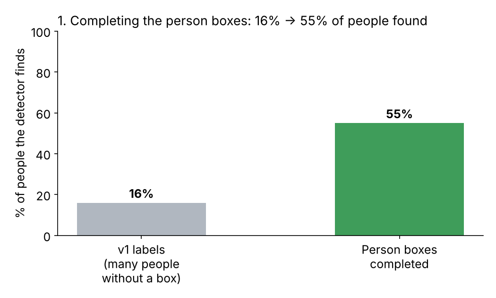
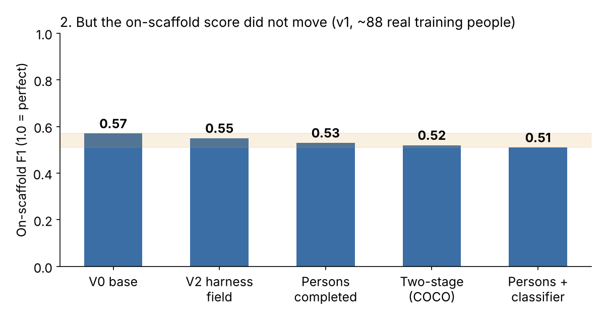
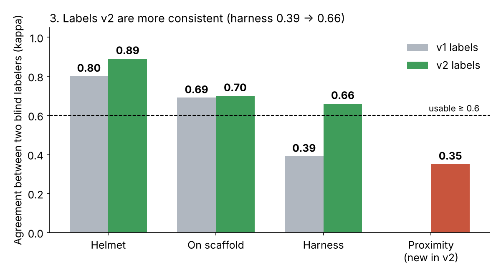
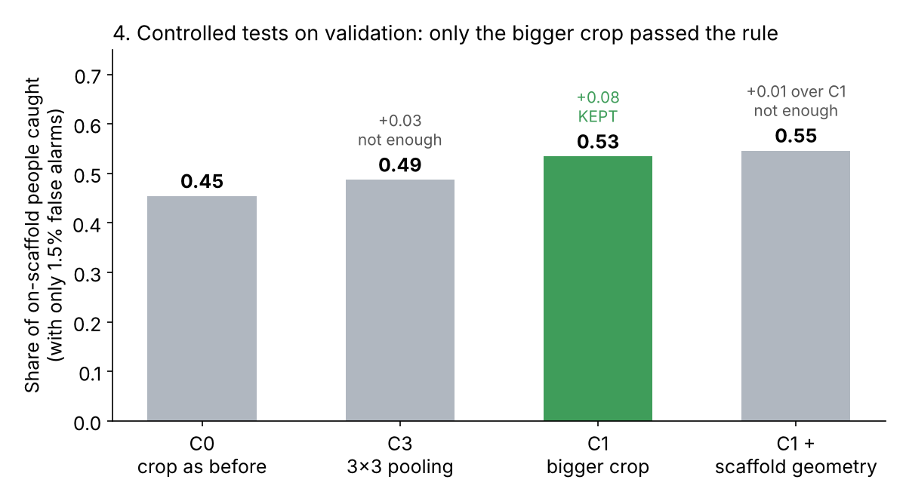
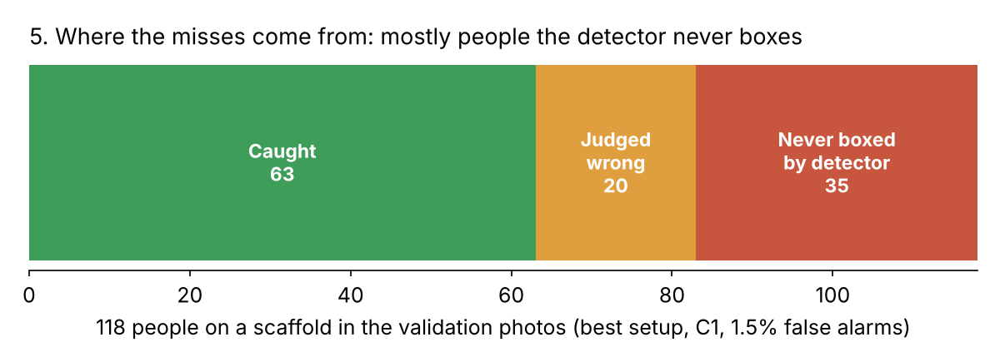

# Results so far (21 Nov 2026)

**The project in one sentence:** from a construction photo, find each person and say three things: helmet yes/no, harness yes/no, and standing on a scaffold yes/no.

**The short story:** helmet and harness work reasonably well. "On a scaffold" is the hard part. We fixed two problems (missing person boxes, inconsistent labels), and one controlled test gave a real gain. The biggest problem left is that the detector never finds many of the small people.

Sources: [Ablation log](ablation_log.md) §9 to §11, [Labeling log](labeling_log.md) §9 to §12, 03 Claude review of Codex analysis, 07 Claude - review of note 06 and next experiment plan, [Labeling v2 and controlled experiment setup](labeling_v2_and_controlled_experiment_setup.md). Numbers checked against the result files on 21 Nov.

---

## The five steps at a glance

| # | What we did | What happened | Simple meaning |
|---|---|---|---|
| 1 | Completed the person boxes | People found: **16% → 55%** | The detector had learned "people are background" because many people had no box |
| 2 | Tried many setups on v1 labels | On-scaffold F1 stuck at **0.51 to 0.57** | The scaffold judgement learned from only ~88 real people. Not enough |
| 3 | Reviewed the research with Codex | Most labeled people sat in the test set, not in training | Fix the split and the labels before collecting more |
| 4 | Built labels v2 | 1,189 images, 3,451 people. Harness agreement **0.39 → 0.66** | More data in training, clearer rules |
| 5 | Ran controlled tests | Bigger crop: **0.45 → 0.53**. Others: not enough | One real gain. Next limit: small people never boxed |

---

## Step 1. The detector could not find people

- **What the number means:** out of every 100 people in the test photos, how many got a box from the detector.
- **Why it was low (16%):** the source datasets only drew boxes on some people. Every person without a box teaches the model "this is not a person".
- **Fix:** a ready-made COCO person detector added the missing boxes (34,459 in training). Result: **55%**.
- **Why it matters:** you can't judge helmet or scaffold on a person you never found.

## Step 2. But "on a scaffold" did not improve

- **F1** is one score that mixes two questions: "of the alarms raised, how many were right" (precision) and "of the people on scaffolds, how many did we catch" (recall). 1.0 is perfect.
- Every setup scored between **0.51 and 0.57**. The extra people found in step 1 were mostly on the ground, so they didn't help this question.
- **Why it was stuck:** the scaffold judgement learned from only **~88 real people** (63 on a scaffold, 18 not on). That is too few examples to learn the difference.
- Label-policy test (§9): best choices were to drop "unclear" people, take harness from the per-person field (harness 0.70 → 0.75), and use the Codex-reviewed labels.

| Split (v1) | Real people with a scaffold label |
|---|---|
| Train | **88** |
| Test | 277 (+ CS10k + held-out) |

## Step 3. What the research review found

Codex read papers on labeling relationships. Claude checked that review (03 Claude review of Codex analysis).

| Point | Simple meaning |
|---|---|
| No paper gives a "magic number" of labels | We have to measure ourselves, with a learning curve |
| Most labeled real people were in **test**, not train | Cheapest fix: a new split and more labels in train, test kept untouched |
| "Codex beats Claude" was scored against Codex's own labels | That comparison is circular, so we need a blind check |
| The model saw a squashed, small crop around each person | It may not see the scaffold under the feet (tested in step 5) |

## Step 4. Labels v2: more people in training, clearer rules

| | v1 | v2 |
|---|---|---|
| Images labeled | 754 | **1,189** |
| People labeled | 1,670 | **3,451** |
| Real "on scaffold" people in train | 63 | **245** |
| Real "not on" people in train | 18 | **1,638** |
| Not-on people per on-scaffold person in train | 0.29 | **6.7** (like real sites: most people are on the ground) |
| Codex-reviewed | all | 986 images (203 wait for Codex until Nov 27) |

- **Agreement (kappa):** two labelers label the same people without seeing each other's work. 1.0 = always agree, 0 = no better than chance. **0.6 is our minimum** to use a field for training. It is also the ceiling for the model: a model can't be more consistent than its labels.
- **Harness 0.39 → 0.66:** the rule changed. "Not worn" now only when the chest and shoulders are visible. Otherwise "not visible". 818 of 1,417 "not worn" became "not visible".
- **Proximity 0.35** (near the edge, new field): too inconsistent, so it is not used as a target yet.
- These are the honest numbers, measured **before** Codex's review (after review they look higher, but that's inflated).

## Step 5. Controlled tests: one real gain

**Rules of the game** (written before any run): pick only on validation photos (118 people on a scaffold, 878 not on). A change is kept only if it beats the baseline by **at least 0.05** and the gain is clearly not luck. The test set has **never been opened**.

**The score:** "recall at 1.5% false alarms" = of the people on a scaffold, how many we catch, while wrongly flagging at most 1.5 of every 100 people who are not on one (13 of 878).

| Test | Idea | Score | Gain | Decision |
|---|---|---|---|---|
| C0 | Crop as before (baseline) | 0.45 | | |
| C3 | Look at the crop in a 3×3 grid | 0.49 | +0.03 | Not kept |
| **C1** | **Bigger crop (3× wide, 2× tall, shape kept)** | **0.53** | **+0.08** | **Kept** |
| C1 + geometry | Add "are the feet inside a scaffold box?" | 0.55 | +0.01 | Not kept |

- **Why the bigger crop works:** the model now sees the scaffold around and under the person.
- **Why geometry adds almost nothing:** the bigger crop already shows the scaffold.
- **Small cost:** with the bigger crop, helmet and harness get slightly worse (0.81 → 0.77, 0.81 → 0.76), so helmet and harness keep the old crop.

## Where we are now: the next bottleneck

- Of the **118** people on a scaffold: **63 caught**, **20** boxed but judged wrong, **35 never boxed** by the detector.
- The 35 are mostly small, far-away people in the CS10k photos (median person height 11.5% of the photo, against 40% elsewhere). No change to the judgement can fix a person who has no box.
- **Next step:** retrain the detector to find small people (higher resolution or a bigger model). This takes hours on the Mac and is **waiting for Luciano's go**.

---

## What to say in the interview (one line each)
- "Missing person boxes cost us most of the people: completing them took recall from 16% to 55%."
- "The relation was data-starved, not model-starved: 88 training people. We fixed the split and relabeled."
- "We measured label agreement, because it's the ceiling for the model, and fixed the harness rule from 0.39 to 0.66."
- "Every change is tested on validation with a rule written in advance. Only the bigger crop passed: +8 points."
- "Today the bottleneck is detecting small people, and we know it because we split every miss into detector miss vs judgement miss."
